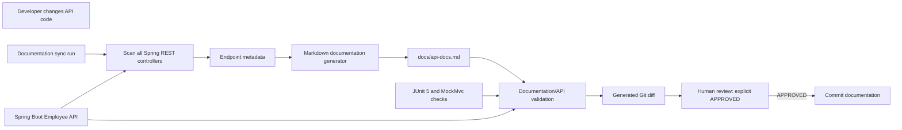

# Employee API Documentation Sync Architecture

## Architecture Overview

This document describes a proposed architecture based on the approved requirements and user story. The inspected repository currently contains project guidance, a README, and the requirements and user-story documents. It does not contain application source code, a Maven build file, API controllers, a documentation-sync implementation, or an existing generated API reference. Therefore, no endpoint is confirmed as implemented.

The proposed system has two cooperating flows:

- A Spring Boot Employee API exposes REST endpoints through annotated Spring MVC controllers.
- A documentation-sync process scans all Spring REST controllers on every run, discovers endpoint metadata, updates only endpoint documentation sections in `docs/api-docs.md`, validates the result against implementation evidence, and presents the generated Git diff for human review. A human must explicitly respond `APPROVED` before documentation is committed. Git-diff detection and GitHub Actions automation are not part of this design.

The approved initial target scope is `GET /api/employees`, `GET /api/employees/{id}`, and `POST /api/employees`. This target scope is distinct from repository implementation status: inspection found no application source or build files, so none of these routes is confirmed as implemented.

## Component Diagram

The components below are proposed, not existing repository components.

## Technology Stack

| Area | Technology or constraint | Status |
| --- | --- | --- |
| Application language | Java | Required by project guidance and story; application not present |
| Web framework | Spring Boot, with Spring MVC controller annotations | Required/proposed; application not present |
| Build | Maven | Required by project guidance; `pom.xml` not present |
| Testing | JUnit 5 and MockMvc | Required by project guidance; tests not present |
| API documentation | Markdown, generated or updated at `docs/api-docs.md` | Required; output file not present |
| Persistence and authentication | No external database or authentication required for the demo | Requirement constraint |
| Documentation sync execution | Scan every Spring REST controller on each sync run | Approved design decision; implementation not present |

No additional library or platform dependency is selected here. The implementation should reuse Spring and project tooling where possible and remain minimal.

## API Architecture

Spring controller annotations are the source of HTTP methods and paths, combining class-level and method-level mappings as needed. DTOs are the source for available request and response model details. Approved requirements are the source for endpoint descriptions. MockMvc tests verify endpoint behavior and documented examples. No value may be inferred or invented when its evidence is unavailable: document it as `Not Found` and report the missing evidence.

The approved initial target scope is:

| Method | Path | Repository status |
| --- | --- | --- |
| GET | `/api/employees` | Not Found: no controller/source evidence |
| GET | `/api/employees/{id}` | Not Found: no controller/source evidence |
| POST | `/api/employees` | Not Found: no controller/source evidence |

No controller/service/data-layer boundaries or response contracts are specified by the inspected repository. Their design is deferred until supported by approved requirements and actual implementation needs.

## Documentation Sync Architecture

1. Each documentation-sync run scans all Spring REST controllers; it is not initiated by Git-diff detection and does not require GitHub Actions automation.
2. Discovery reads Spring controller annotations for implemented HTTP methods and paths, and DTOs for available request and response model details. Approved requirements supply endpoint descriptions.
3. MockMvc tests verify behavior and examples. Any unverifiable information is marked `Not Found`, with the missing evidence reported; values are never invented.
4. The generator updates only endpoint documentation sections in `docs/api-docs.md`, preserving unrelated Markdown content.
5. Validation compares every implemented endpoint with its documented method, path, and available model details; verifies examples against the available evidence; checks for duplicate sections and contradictions; and checks idempotence by confirming a repeat run with unchanged inputs produces no documentation changes.
6. Validation passes only when all implemented endpoints are correctly documented, there are no duplicates or contradictions, and all required details are verified. Unresolved required information fails validation. Unavailable optional information may be documented as `Not Found` and must be reported.
7. Present the generated Git diff to a human reviewer. Documentation may be committed only after the reviewer explicitly responds `APPROVED`; displaying the diff is a review step, not a sync trigger.

The generator should be deterministic for identical source inputs so that reviewable changes represent API or evidence changes rather than formatting noise. This is a proposed design property, not a repository capability observed today.

## Data Flow

1. A documentation-sync run scans every Spring REST controller, regardless of which files changed.
2. Annotation discovery extracts implemented methods and paths; DTOs supply available model details; approved requirements supply descriptions; MockMvc tests verify behavior and examples.
3. The generator updates only endpoint documentation sections in `docs/api-docs.md`; unrelated Markdown is preserved. Unsupported information is shown as `Not Found` and reported.
4. Validation checks route and model parity, examples, duplicates, contradictions, and idempotence. Missing required evidence fails validation; unavailable optional information is reported as `Not Found`.
5. The generated Git diff is presented to a human reviewer. Commit is blocked until the reviewer explicitly responds `APPROVED`.

## Key Architecture Decisions

- Spring controller annotations source HTTP methods and paths; DTOs source model details; approved requirements source descriptions; MockMvc tests verify behavior and examples.
- Every sync run scans all Spring REST controllers. Git-diff detection and GitHub Actions automation are not required; the Git diff is generated only for human review.
- Unverifiable information is marked `Not Found` and missing evidence is reported; API values are never invented.
- Validation covers implemented methods, paths, available model details, verified examples, duplicate sections, contradictions, and idempotence. It passes only when all implemented endpoints are documented correctly and all required details are verified.
- Required information without verified evidence fails validation; unavailable optional information may be `Not Found` and must be reported.
- Documentation is generated or updated as Markdown at `docs/api-docs.md`, as required by FR-3.
- The generated Git diff is presented to a human reviewer, and only an explicit `APPROVED` permits committing documentation (FR-8 and AC7).
- Approved target scope includes `GET /api/employees`, `GET /api/employees/{id}`, and `POST /api/employees`; implementation status is determined only by repository evidence.
- The sync process updates only endpoint documentation sections and preserves unrelated Markdown content (FR-6).
- The architecture remains dependency-light; no extra library, CI provider, storage service, or database has been selected without repository or requirement evidence.

## Assumptions and Risks

- **Repository maturity:** Inspection found no Java source, DTOs, `pom.xml`, tests, or generated API docs. All three approved target routes have implementation status `Not Found`; this is an inspection finding, not a claim that they are implemented or absent from another system.
- **Evidence availability:** Controller annotations, DTOs, approved endpoint descriptions, and MockMvc tests are the specified evidence sources, but none is present in this repository. Required details therefore cannot currently pass validation; unavailable optional details can be marked `Not Found` and reported.
- **Review gate:** A generated Git diff is for human review only. The sync run does not depend on Git-diff detection or GitHub Actions, and commit requires the explicit response `APPROVED`.

## Handoff

This architecture is based on the approved requirements and user story and the repository state inspected for this stage. This document is the Architecture-stage handoff; Design Review and Planning are outside this update. No application code or later SDLC-stage artifacts were created.